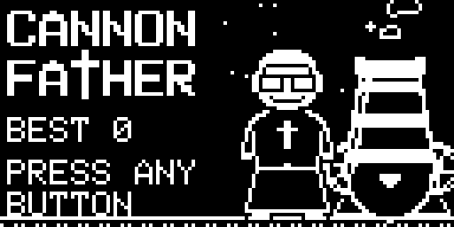
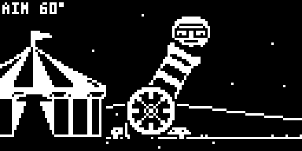
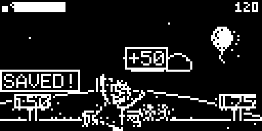

# Cannon Father



Father is a priest with a cannon and a mission from the Pope: the flock has
wandered far, and the bus isn't coming. Fire him as far as you can, bounce off
everything in sight, and spread the good word along the way.

By **jaychugstein** · MIT License · Arduboy FX / FX-C (uses the FX flash chip).

**Play it in your browser:** https://jaychugstein.github.io/Cannon-Father/ (works on phones too)

 

## Controls

| Button | What it does |
|---|---|
| Up / Left | Raise the cannon |
| Down / Right | Lower the cannon |
| Outer button | Start, set the aim, fire (hit the top of the power bar for a PERFECT shot) |
| Inner button | Hold in the air to glide (Father spreads his cassock) |

One launch per round, then a Flight Report and back to the start.

## Sound

After the title, a church bell asks whether you want sound: arrows switch it ON or OFF
(it rings DING... DONG, or hangs still: SHHH...), A or B carries on. **Joyful, Joyful,
We Adore Thee** (Beethoven's Ode to Joy, public domain) plays on the menus and while you
aim. In the air, everything he hits makes its own sound: boing, sproing, BOOM, whoosh,
splat, pop, coo, DING, a hallelujah for the angel wings, a chime for every soul saved.

## What's out there

**On the ground:** trampolines, springs, bombs, 30° ramps, ground cannons that
relaunch him, updraft fans, mud, hay bales and cactuses.

**In the air:** stars, balloons, doves, church bells and angel wings.

Every hit knocks bibles loose. A bible that lands in a crowd **saves** them.
Everything is placed randomly for each launch.

The Flight Report shows distance, top speed, max height, air time, flips,
bounces, bibles dropped, souls saved, your total and your rank — from
**Altar Boy** all the way up to **Saint**.

## Install

Load `release/CannonFather.arduboy` with any FX-aware uploader (for example the
Arduboy Web Flasher or the Arduboy-Python-Utilities), or the `.hex` together
with `release/CannonFather-fxdata.bin`.

The game is built with `ARDUBOY_NO_USB` to save space, like most cart games:
to upload something else afterwards, press reset when the uploader asks.

## Building from source

The sketch is in `CannonFather/` (game code in `game.cpp`) and needs the
**Arduboy2**, **ArduboyFX** and **ArduboyTones** libraries.

* **Arduino IDE:** open `CannonFather/CannonFather.ino`, pick an Arduboy board,
  compile, then upload `CannonFather/fxdata/fxdata.bin` as the FX data.
* **Command line:** `./build.sh` (edit the paths at the top) → `build/CannonFather.hex`.

All the art (sprites, the animated home screen, the controls screen) is drawn
by Python scripts in `art/` and packed into the FX data:

```
cd art && python3 gen2.py      # needs Pillow; rewrites CannonFather/fxdata/ and the headers
```

## Browser version

`docs/` is a small web page that runs the real game file in the
[Ardens](https://github.com/tiberiusbrown/Ardens) emulator (MIT, by Peter Brown).
It's served by GitHub Pages from the `docs` folder.

## License

MIT — see [LICENSE](LICENSE). Uses the Arduboy2 (BSD 3-Clause), ArduboyFX (CC0) and
ArduboyTones (BSD 3-Clause) libraries; `art/font5x7.py` is the Arduboy2 font.
